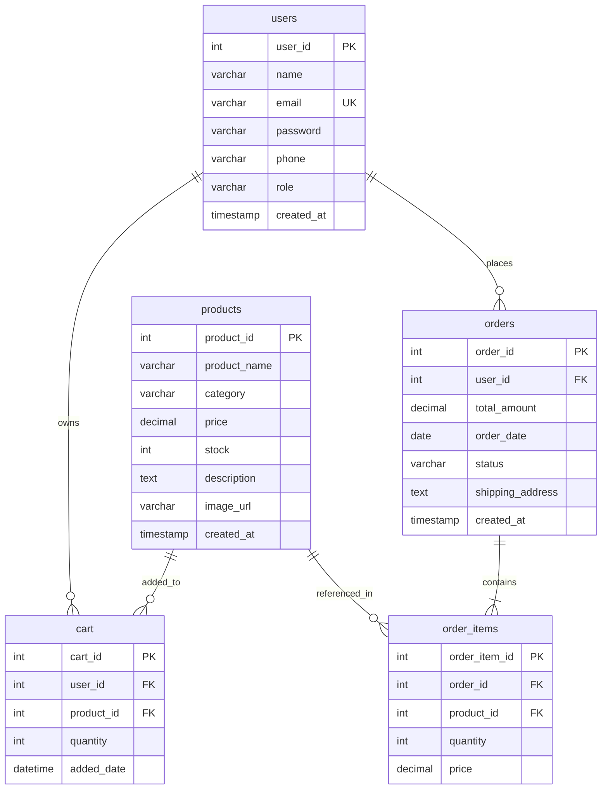

# 🛍️ Parthu Reddy's Online Cart Management System

A premium, full-stack responsive e-commerce web application engineered with **HTML5, Modern CSS3, JavaScript, Node.js, Express.js, and MySQL (InnoDB)**.

Runs locally at **`http://localhost:3000`**.

---

## 🌟 Key Highlights & Design

- **Branded Experience**: "Parthu Reddy's Online Cart Management System" branded across all views.
- **Color Palette & Design**: Deep navy (`#0B192C`, `#1E3E62`), crisp white, and vibrant blue accents (`#2563EB`, `#3B82F6`) with status badges and micro-animations.
- **100% Real Database**: No mock data or localStorage-as-database. All products, cart items, customer accounts, orders, and stocks are read from and written to MySQL.
- **ACID Transaction Order Processing**: Server-side price calculation, stock verification and row locking, automatic stock decrement, cart clearing, and transactional rollback on failure.
- **Role-Based Access Control**: Secure Bcrypt password hashing and JWT token authentication protecting customer routes and admin control panels.
- **Live Database Status Indicator**: Real-time connection feedback in the top bar with one-click setup assistance and auto-reconnect retry.

---

## 🏗️ Architecture & Database Schema

The database `parthu_cart_db` runs on the **InnoDB** engine with foreign key constraints and transactional integrity:



### Table Specifications

1. **`users`**
   - `user_id` INT PRIMARY KEY AUTO_INCREMENT
   - `name` VARCHAR(100) NOT NULL
   - `email` VARCHAR(100) NOT NULL UNIQUE
   - `password` VARCHAR(255) NOT NULL (Bcrypt hashed)
   - `phone` VARCHAR(15)
   - `role` VARCHAR(20) DEFAULT `'customer'`

2. **`products`**
   - `product_id` INT PRIMARY KEY AUTO_INCREMENT
   - `product_name` VARCHAR(150) NOT NULL
   - `category` VARCHAR(50) NOT NULL
   - `price` DECIMAL(10,2) NOT NULL
   - `stock` INT NOT NULL DEFAULT 0
   - `description` TEXT
   - `image_url` VARCHAR(255)

3. **`cart`**
   - `cart_id` INT PRIMARY KEY AUTO_INCREMENT
   - `user_id` INT NOT NULL, FOREIGN KEY REFERENCES `users(user_id)` ON DELETE CASCADE
   - `product_id` INT NOT NULL, FOREIGN KEY REFERENCES `products(product_id)` ON DELETE CASCADE
   - `quantity` INT NOT NULL DEFAULT 1
   - `added_date` DATETIME DEFAULT CURRENT_TIMESTAMP
   - `UNIQUE KEY (user_id, product_id)`

4. **`orders`**
   - `order_id` INT PRIMARY KEY AUTO_INCREMENT
   - `user_id` INT NOT NULL, FOREIGN KEY REFERENCES `users(user_id)`
   - `total_amount` DECIMAL(10,2) NOT NULL (Server calculated)
   - `order_date` DATE NOT NULL
   - `status` VARCHAR(30) DEFAULT `'Pending'` ('Pending', 'Processing', 'Shipped', 'Delivered', 'Cancelled')
   - `shipping_address` TEXT

5. **`order_items`**
   - `order_item_id` INT PRIMARY KEY AUTO_INCREMENT
   - `order_id` INT NOT NULL, FOREIGN KEY REFERENCES `orders(order_id)` ON DELETE CASCADE
   - `product_id` INT NOT NULL, FOREIGN KEY REFERENCES `products(product_id)`
   - `quantity` INT NOT NULL
   - `price` DECIMAL(10,2) NOT NULL (Frozen historical price)

---

## 👥 Features Overview

### 🛍️ Customer Features
1. **Registration & Login**: Secure account creation with validation and Bcrypt password hashing.
2. **Homepage**: Hero banner, live catalog, featured tech cards, and trust badges.
3. **Browse & Filter**: Filter by category pills, search by name/description, slider filter by max price, sort by price or name.
4. **Quick View Modal**: Inspect detailed product specifications, stock status badge, and quantity selector.
5. **Slide-Over Shopping Cart**:
   - Add products to cart with stock validation.
   - Adjust quantities with `+` / `-` buttons.
   - Remove items.
   - Real-time auto-calculation of Subtotal, 5% Tax, Shipping, and Grand Total.
6. **Checkout & Order Placement**:
   - Atomic database transaction verifying stock, deducting units, saving order and items, and clearing cart.
7. **Customer Dashboard (`/customer-dashboard.html`)**:
   - Lifetime spend and order metrics.
   - Full order history table with status badges.
   - Expandable order item breakdown modal.
   - Order cancellation for Pending orders with automatic stock restoration.

### ⚙️ Administrator Features (`/admin.html`)
1. **Secure Admin Login**: Dedicated role verification (`requireAdmin` middleware).
2. **Real-time Analytics**: Real product count, total registered customers, total orders, and total revenue.
3. **Low-Stock Alerting**: Highlights products with stock $\le 5$ with a quick restock prompt.
4. **Product CRUD**:
   - Add new product with category, price, stock, description, and image URL.
   - Edit existing product details.
   - Delete product with modal confirmation (protects historical orders).
   - Quick inline stock updater without full edit form.
5. **Order Management**:
   - View all customer orders with customer details and address.
   - Live status changer dropdown: `Pending` $\rightarrow$ `Processing` $\rightarrow$ `Shipped` $\rightarrow$ `Delivered` $\rightarrow$ `Cancelled`.
   - Automatic stock restoral when orders are cancelled.
6. **Customer Roster**:
   - View all registered customers, contact info, total orders placed, and lifetime spend.

---

## 🚀 Quick Setup & Installation

### 1. Prerequisites
- **Node.js** (v18 or higher)
- **MySQL Server** (8.0+ or XAMPP / WampServer / MariaDB)

### 2. Configure Environment (`.env`)
The `.env` file is located in the root of the project:

```ini
PORT=3000
DB_HOST=localhost
DB_USER=root
DB_PASSWORD=your_mysql_password_here
DB_NAME=parthu_cart_db
DB_PORT=3306
JWT_SECRET=parthu_reddy_super_secret_jwt_key_2026_secure
JWT_EXPIRES_IN=24h
```

> **Note**: Update `DB_PASSWORD` to match your local MySQL root password.

### 3. Initialize Database & Tables
Run the automated schema and seed script:
```bash
npm run init-db
```
*(Alternatively, simply starting the server with `npm start` will automatically create the database `parthu_cart_db`, create all 5 tables, and seed initial products and demo accounts if they do not exist!)*

### 4. Start the Application
```bash
npm start
```
Open your browser and navigate to:
👉 **`http://localhost:3000`**

---

## 🔑 Pre-Seeded Demo Accounts

| Role | Email | Password |
|---|---|---|
| **Admin** | `admin@parthucart.com` | `Admin@123` |
| **Customer** | `john@example.com` | `Customer@123` |

*(Quick 1-click Demo Buttons are provided on the Login page for instant login testing).*

---

## 📂 Project Structure

```
shopping cart management system/
├── package.json               # Dependencies and scripts
├── .env                       # Active environment credentials
├── .env.example               # Environment template
├── server.js                  # Express application entry point (Port 3000)
├── config/
│   └── db.js                  # MySQL pool & auto-migration engine
├── database/
│   ├── init.sql               # Pure SQL schema & seed script
│   └── setupDb.js             # Standalone CLI database initializer
├── middleware/
│   └── auth.js                # JWT verification & Admin role guard
├── routes/
│   ├── authRoutes.js          # Register, Login, Current User profile
│   ├── productRoutes.js       # Product catalog, search, filter, categories
│   ├── cartRoutes.js          # Cart CRUD & stock validation
│   ├── orderRoutes.js         # Transactional checkout, history, cancellation
│   └── adminRoutes.js         # Admin dashboard, products CRUD, order management
├── public/                    # Frontend UI (Served by Express)
│   ├── index.html             # Homepage, Catalog, Cart Drawer, Modals
│   ├── login.html             # Customer & Admin Authentication page
│   ├── customer-dashboard.html# Customer Order History & Profile
│   ├── admin.html             # Full-featured Admin Management Suite
│   ├── css/
│   │   └── style.css          # Deep navy & blue design system, responsive styles
│   └── js/
│       ├── api.js             # API client, JWT handler, Toast notifications
│       ├── app.js             # Homepage catalog & cart drawer logic
│       ├── auth.js            # Sign in & registration handler
│       ├── customer.js        # Customer orders controller
│       └── admin.js           # Admin CRUD, stock & order status controller
└── tests/
    ├── verify.js              # Server boot & endpoint integration test
    └── auth.test.js           # Bcrypt & JWT verification test
```

---

## 🛡️ Security & Order Processing Flow

1. **Client Request**: Customer clicks "Confirm & Place Order".
2. **Server-Side Price Validation**: The server queries the MySQL database inside a `START TRANSACTION`, locking cart rows with `FOR UPDATE`.
3. **Stock Verification**: Compares requested quantities against live product stock.
4. **Order Insertion**: Inserts into `orders` with server-calculated total (Subtotal + 5% Tax + Free Shipping over $500).
5. **Line Item Insertion**: Copies each product's current price into `order_items`.
6. **Stock Decrement**: Executes `UPDATE products SET stock = stock - quantity WHERE product_id = ...`.
7. **Cart Clearance**: Executes `DELETE FROM cart WHERE user_id = ...`.
8. **Commit**: Commits all actions. If any check fails, rolls back completely.
